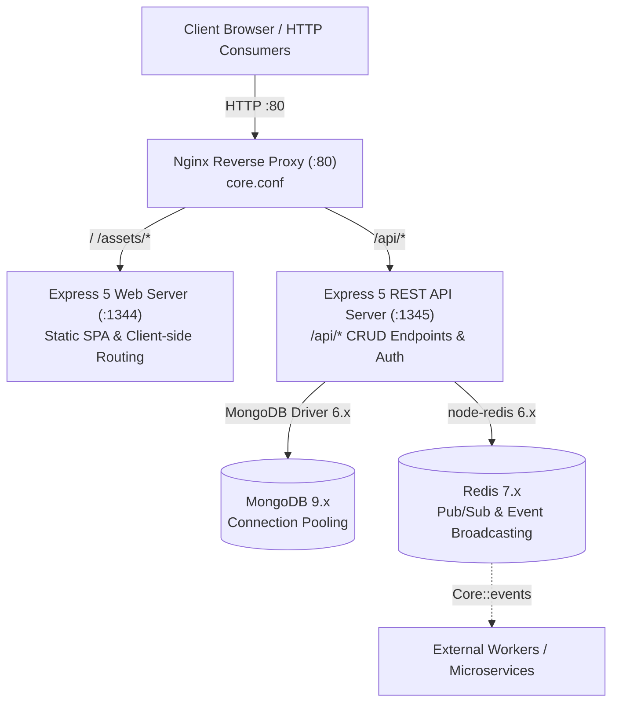
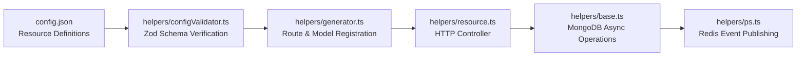

# Core Platform Architecture

This document provides a comprehensive overview of the Core Platform architecture, system design, data flows, and runtime topology.

---

## High-Level Architecture

The Core Platform is an enterprise full-stack application built with **Node.js 24 (LTS)** and **TypeScript (ES2024)**. It pairs an Express 5 REST API and Web server with a **React 19 Single-Page Application (SPA)**, backed by **MongoDB 9** and **Redis 7+ Pub/Sub**.



---

## Server Topology

The application orchestrates two decoupled HTTP services via [`src/server.ts`](../src/server.ts) and [`app.js`](../app.js):

1. **Web & SPA Server (`PORT_WEB`, Default `1344`):**
   - Serves the compiled React 19 SPA from `public/dist/`.
   - Handles public asset distribution from `public/`.
   - Serves SPA HTML fallback for client-side deep routing (`/account`, `/docs`, etc.).
   - Mounts the REST API locally under `/api` in development or single-host modes.

2. **REST API Server (`PORT_API`, Default `1345`):**
   - Provides stateless RESTful endpoints for authentication, resource CRUD, and system operations.
   - Enforces token authentication, schema validation, rate limiting, and NoSQL query sanitization.
   - Automatically mounts dynamic endpoints defined in [`config.json`](../config.json).

---

## Socket.IO Retirement & Redis Event Broadcasting

### Architecture Transition

Earlier versions of the platform utilized Socket.IO for client-side WebSocket connections. To achieve:

- **Stateless horizontal scalability** without sticky sessions
- **Zero WebSocket connection overhead** on frontend clients
- **Clean separation of concerns** between HTTP clients and event consumers

**Socket.IO was retired and removed**. Client applications interact with the platform exclusively through clean, cache-friendly RESTful HTTP endpoints.

### Redis 7+ Pub/Sub Event Broadcasting

Event broadcasting is handled asynchronously on the backend via [`helpers/ps.ts`](../helpers/ps.ts) using Redis 7+ Pub/Sub:

- Whenever resources are mutated (**create**, **update**, **delete**) through [`helpers/resource.ts`](../helpers/resource.ts), a `ResourceChangeEvent` is published to the Redis channel:
  ```
  ${config.site || "Core"}::events
  ```
- **Event Payload Structure:**
  ```typescript
  export interface ResourceChangeEvent {
    resource: string;
    action: "create" | "update" | "delete";
    id?: string;
    userId?: string;
    timestamp: number;
  }
  ```
- This allows external microservices, background job workers, audit loggers, or notification dispatchers to subscribe to data changes without placing long-lived stateful socket connections on the primary API server.

---

## Dynamic Configuration-Driven CRUD

The platform dynamically constructs models, controllers, and REST routes at runtime from declarative definitions in [`config.json`](../config.json):



1. **Schema Whitelisting (`helpers/filters.ts`):** Only fields explicitly defined in the resource schema are accepted on mutation requests (`POST`, `PUT`).
2. **Response Cleaners (`helpers/filters.ts`):** Fields specified under `clean` (e.g., passwords, secret keys) are stripped before JSON serialization.
3. **Role Guards:** Resources with `"admin": true` reject requests missing valid administrator tokens with `401 Unauthorized`.
4. **Viewer Guards:** Authenticated accounts with the `"viewer"` role are permitted `GET` (read-only) actions while mutation requests (`POST`, `PUT`, `DELETE`) are rejected with `403 Forbidden`.

---

## Authentication & Security Hardening

- **Token-Based Authentication:** Tokens are sent via the `token` HTTP request header and verified against the `tokens` collection in MongoDB.
- **Constant-Time Verification:** Passwords and tokens are validated using `crypto.timingSafeEqual` in [`helpers/utils.ts`](../helpers/utils.ts) to prevent timing side-channel attacks.
- **Deterministic Key-Derived Password Encryption:** Passwords are encrypted with AES-256-CBC, using SHA-256 and MD5 hashes derived deterministically from the user's MongoDB `_id`.
- **Token Bucket Rate Limiting:** Sensitive endpoints (`/login`, `/security`) enforce rate limits via [`helpers/middleware.ts`](../helpers/middleware.ts).
- **NoSQL Injection Sanitization:** Recursive object cleaners strip Mongo query operators (`$`, `.`) from request query and body parameters.
- **Security Headers:** Enforces `X-Content-Type-Options: nosniff`, `X-Frame-Options: SAMEORIGIN`, and `Referrer-Policy: strict-origin-when-cross-origin`.

---

## Frontend Architecture

The client is a Single-Page Application (SPA) located in [`src/client/`](../src/client/):

- **Runtime & Tooling:** Built with **React 19**, **TypeScript**, and **Vite 8** (`vite.config.mts`).
- **Dynamic Autoforms:** [`src/client/components/DynamicForm.tsx`](../src/client/components/DynamicForm.tsx) renders dynamic forms based on schema types (`text`, `number`, `select`, `date`, `checkbox`).
- **Design System:** Bespoke offline CSS theme system with live theme switching via [`src/client/context/ThemeContext.tsx`](../src/client/context/ThemeContext.tsx).
- **Authentication Context:** [`src/client/context/AuthContext.tsx`](../src/client/context/AuthContext.tsx) manages local session state and role privileges.
