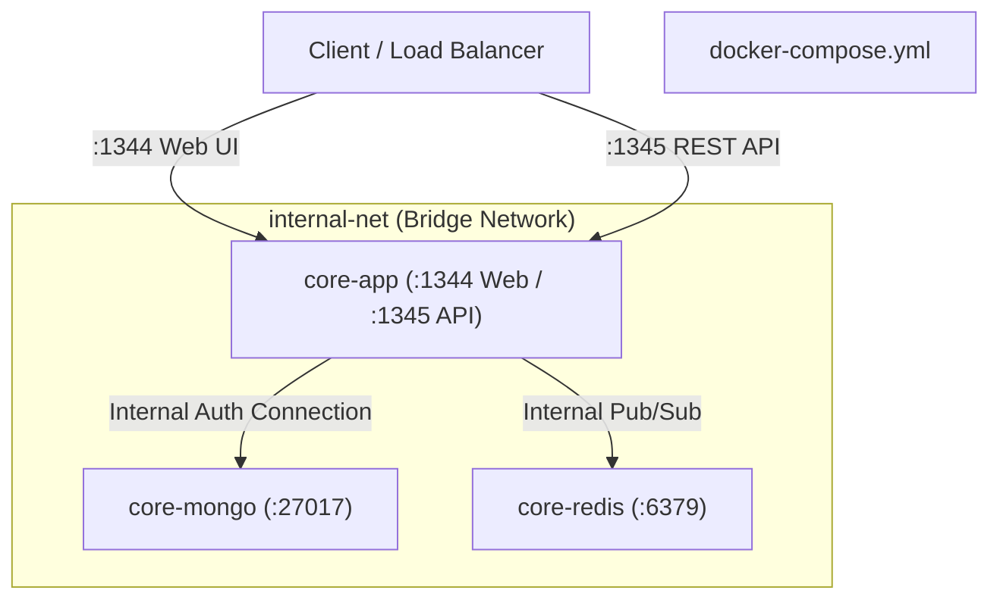

# Deployment & Operations Guide

This guide covers production deployment configurations, containerized execution, reverse proxy setups, and environment variable references for the Core Platform.

---

## Production Build & Start

To build and start Core Platform in production mode:

```bash
# 1. Install production dependencies
npm ci --omit=dev

# 2. Build TypeScript and compile Vite React 19 SPA
npm run build

# 3. Start unified production server
npm start
```

---

## Docker & Containerization

A complete multi-container setup is orchestrated via [`docker-compose.yml`](../docker-compose.yml) and [`Dockerfile`](../Dockerfile).



### Starting the Stack with Docker Compose

```bash
# Start all services in the background
docker compose up -d

# Stream logs
docker compose logs -f app

# Stop the stack
docker compose down
```

### Security & Isolation Guarantees:

- **Port Isolation:** Database (`27017`) and cache (`6379`) ports are kept strictly internal to `internal-net` and never exposed to the host network interface.
- **Healthchecks:** Container startup order enforces service readiness via native ping probes (`mongosh` ping for MongoDB, `redis-cli ping` for Redis).
- **Persistent Storage:** Named volumes (`mongodb_data`, `redis_data`) guarantee state persistence across container teardowns.

---

## Nginx Reverse Proxy Configuration (`core.conf`)

An optimized Nginx configuration is provided in [`core.conf`](../core.conf) to proxy incoming web traffic and REST API calls:

```nginx
upstream coreweb {
  server 127.0.0.1:1344;
}

upstream coreapi {
  server 127.0.0.1:1345;
}

server {
  gzip on;
  gzip_types text/plain text/css application/json application/javascript text/xml application/xml application/xml+rss text/javascript;
  listen 80;
  server_name localhost _;

  # Frontend Web & SPA Fallback
  location / {
    proxy_pass http://coreweb;
    proxy_http_version 1.1;
    proxy_set_header Upgrade $http_upgrade;
    proxy_set_header Connection "Upgrade";
    proxy_set_header Host $http_host;
    proxy_set_header X-Forwarded-For $remote_addr;
    proxy_set_header X-Forwarded-Proto $scheme;
  }

  # REST API Service (Strip /api prefix and forward to coreapi)
  location /api/ {
    rewrite ^/api(/.*)$ $1 break;
    proxy_pass http://coreapi;
    proxy_http_version 1.1;
    proxy_set_header Host $http_host;
    proxy_set_header X-Forwarded-For $remote_addr;
    proxy_set_header X-Forwarded-Proto $scheme;
  }
}
```

---

## Environment Variables Reference

| Variable         | Default                             | Description                                               |
| :--------------- | :---------------------------------- | :-------------------------------------------------------- |
| `NODE_ENV`       | `development`                       | Runtime environment (`development`, `production`, `test`) |
| `PORT_WEB`       | `1344`                              | Port for Express Web server & React 19 SPA                |
| `PORT_API`       | `1345`                              | Port for Express REST API service                         |
| `PORT_REDIS`     | `6379`                              | Redis port override                                       |
| `MONGODB_URI`    | `mongodb://127.0.0.1:27017/coreapp` | MongoDB connection string with credentials                |
| `REDIS_URL`      | `redis://127.0.0.1:6379`            | Redis connection URL                                      |
| `GUEST_ENABLED`  | `true`                              | Enable / disable demo guest account access                |
| `GUEST_EMAIL`    | `guest@example.com`                 | Default guest account email                               |
| `GUEST_PASSWORD` | `GuestSecurePass123!`               | Default guest account password                            |
